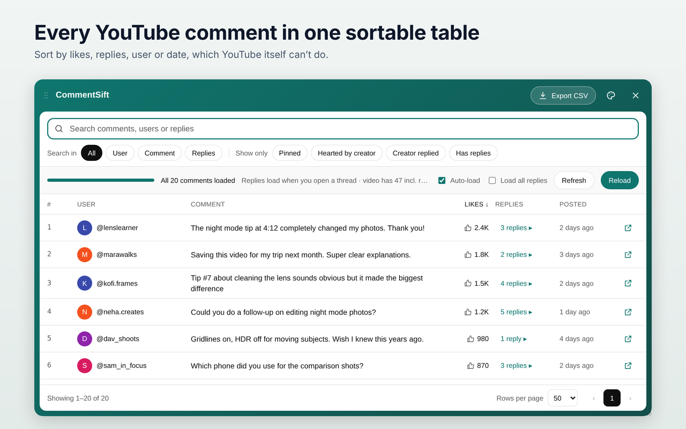
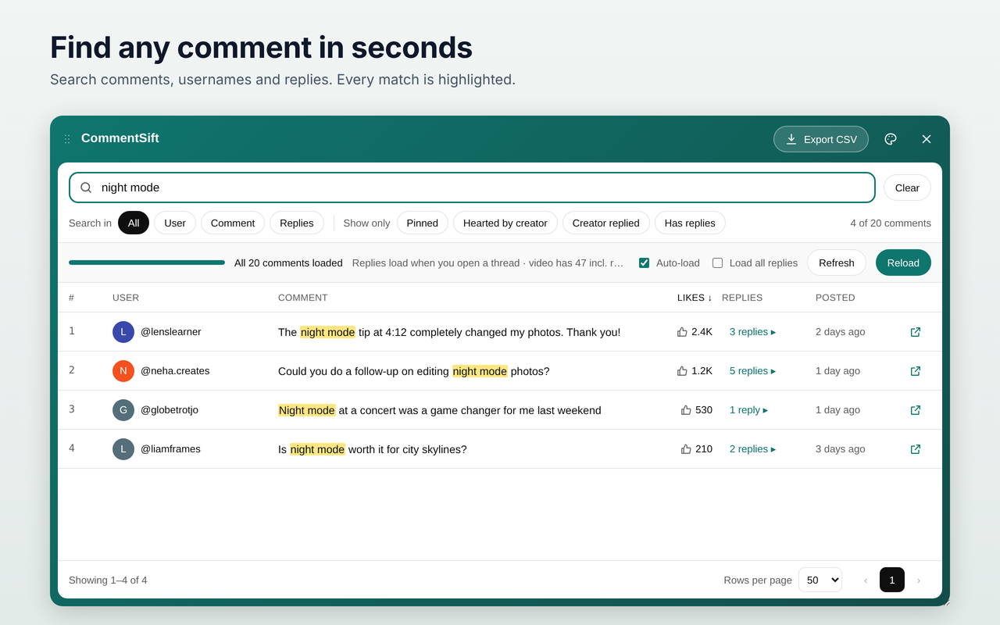
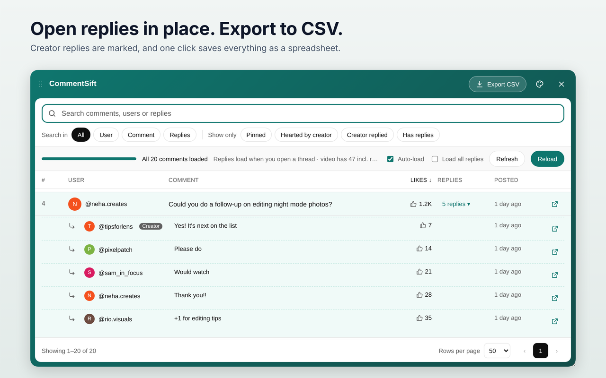
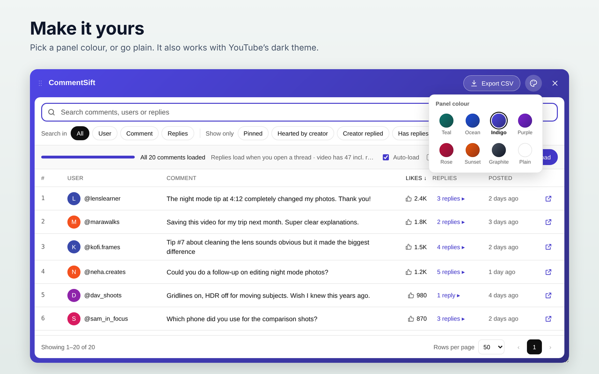
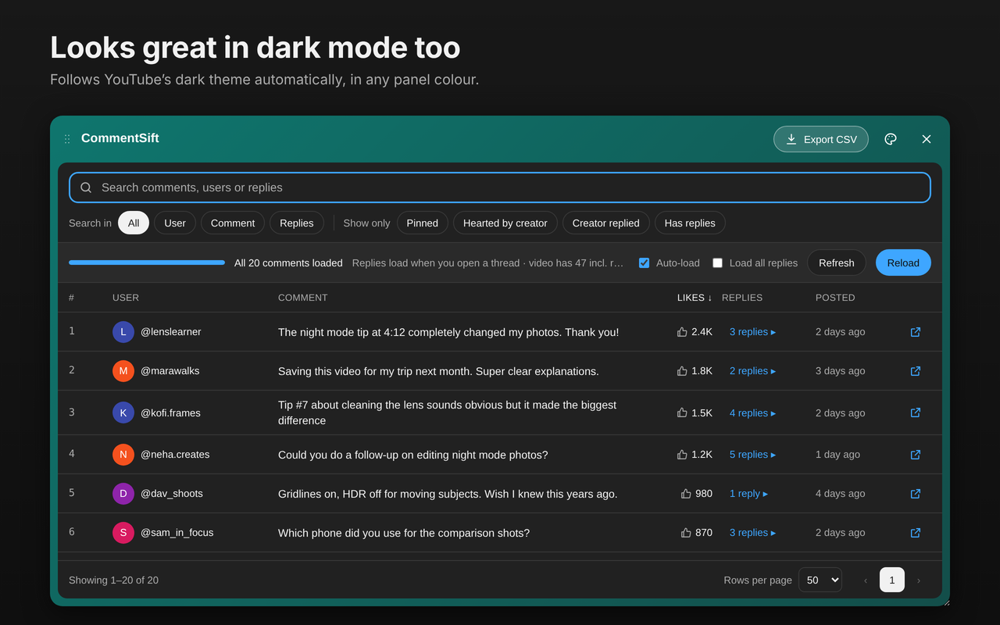

  

<h1 align="center">CommentSift</h1>

<b>Search, sort and export YouTube comments in a clean table.</b> 
A free Chrome extension that runs entirely in your browser.

  <a href="https://krishnar0929.github.io/commentsift/">Website</a> ·
  <a href="https://krishnar0929.github.io/commentsift/privacy.html">Privacy policy</a> ·
  <a href="../../issues">Report a problem</a>

## Why

YouTube only lets you sort comments by "Top" or "Newest", and there's no way to search them. CommentSift adds what's missing.

## Features

- **Search every comment:** find any word in comments, usernames or replies, with every match highlighted.
- **Sort the way you want:** by likes, number of replies, username or date.
- **Quick filters:** pinned comments, comments hearted by the creator, threads the creator replied to, comments with replies.
- **Replies in place:** open any thread inside the table. Creator replies are marked.
- **Export to CSV:** save comments as a spreadsheet for Excel or Google Sheets.
- **Jump to any comment** on the page with one click.
- **Panel colours:** Teal, Ocean, Indigo, Purple, Rose, Sunset, Graphite or Plain. Works with YouTube's dark theme.

| Search | Replies & export |
|---|---|
|  |  |
| **Colours** | **Dark mode** |
|  |  |

## How to use

1. Install CommentSift from the Chrome Web Store.
2. Open any YouTube video and scroll to the comments.
3. Click **Table view** next to YouTube's "Sort by", or press **Alt+Shift+C**.

The table opens right away and keeps loading the rest of the comments in the background, without scrolling the page. Replies load when you open a thread.

## Privacy

CommentSift has no servers, needs no account and collects no data. It reads only the comments on the video you're viewing, inside your browser. See the full [privacy policy](PRIVACY.md).

## Support

Found a bug or have an idea? [Open an issue](../../issues) or email krishnam.techie@gmail.com.

---

CommentSift is an independent tool and is not affiliated with or endorsed by YouTube or Google.
